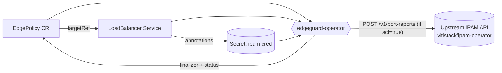

# 🛡️ edgeguard-operator

> A Kubernetes operator that guards LoadBalancer Services at the edge — discovering their ports and ingress IPs, protecting them with finalizers, and reporting them to an upstream IPAM / edge API.

<p>
  
  
  
  
  
</p>

---

## 📖 Overview

`edgeguard-operator` introduces a single Custom Resource — **`EdgePolicy`** — that attaches a security and discovery policy to a Kubernetes `Service` of type `LoadBalancer` in the same namespace.

For each `EdgePolicy` the operator:

- 🔗 **Protects the target Service** with a finalizer, so the policy can react before the Service is deleted.
- 🔎 **Discovers** the Service's ports and load balancer ingress IPs (split into IPv4 / IPv6).
- 📡 **Reports** the discovered state to an external upstream API (opt-in via `spec.acl`), enriched with an IPAM zone and a credential resolved from a Kubernetes `Secret`.
- 🌍 **Declares an allowed region** policy (`norway` / `nordics` / `europe`) plus optional extra CIDR allowances.
- 🧭 **Surfaces everything on `.status`** as standard `metav1.Condition`s, visible with `kubectl get edgepolicies`.

Reconciliation is **idempotent** and tolerant: missing Secrets, missing upstream configuration, and transient upstream outages are surfaced on the status rather than crashing the reconcile loop.

> 🔗 **Dependency:** `edgeguard-operator` is designed to work alongside the [**vitistack/ipam-operator**](https://github.com/vitistack/ipam-operator). The IPAM operator provisions the LoadBalancer addressing and backs the upstream IPAM API that receives the port reports; the `ipam.vitistack.io/zone` and `ipam.vitistack.io/secret` Service annotations map to its zone and credential model.

---

## ⚙️ How it works



1. An `EdgePolicy` references a `Service` by name via `spec.targetRef`.
2. The operator adds a finalizer to the Service and reads its ports and ingress IPs.
3. If `spec.acl` is enabled, it resolves the IPAM credential + zone and **POSTs a port report** upstream.
4. The policy `.status` reflects the outcome through the `Ready`, `IpamSecretReady`, and `UpstreamReady` conditions.

---

## 🧩 The `EdgePolicy` API

**Group / Version / Kind:** `security.vitistack.io/v1alpha1`, `Kind: EdgePolicy` (short name: `epol`)

### Spec fields

| Field | Type | Required | Description |
|-------|------|----------|-------------|
| `targetRef.apiVersion` | string (`v1`) | ✅ | API version of the target. Only `v1` is supported. |
| `targetRef.kind` | string (`Service`) | ✅ | Target kind. Only `Service` is supported. |
| `targetRef.name` | string | ✅ | Name of the target Service, in the **same namespace** as the policy. |
| `acl` | bool | ⬜ | Enables service port discovery **and** upstream reporting. |
| `allowedRegion.region` | enum | ⬜ | One of `norway`, `nordics`, `europe`. |
| `allowedRegion.additionalAllowList` | []CIDR | ⬜ | Extra IPv4/IPv6 CIDRs allowed regardless of region (max 256). |

> ℹ️ Validation rule: **at least one** of `acl` or `allowedRegion` must be set.

### Example

```yaml
apiVersion: security.vitistack.io/v1alpha1
kind: EdgePolicy
metadata:
  name: my-edge-policy
  namespace: default
spec:
  targetRef:
    apiVersion: v1
    kind: Service
    name: my-service
  acl: true
  allowedRegion:
    region: norway
    additionalAllowList:
      - 192.0.2.0/24
      - 2001:db8::/48
```

### Target Service annotations

When `acl` is enabled, the operator reads these annotations from the **target Service**:

| Annotation | Purpose |
|------------|---------|
| `ipam.vitistack.io/zone` | Reported upstream as `ipamZone`. |
| `ipam.vitistack.io/secret` | Name of the `Secret` holding the IPAM credential. The special value `default` resolves to `ipam-system/default`; any other value resolves to a Secret of that name in the Service's own namespace. The credential is read from the Secret's **`secret`** data key. |

---

## 📊 Status & conditions

Check a policy at a glance:

```sh
kubectl get edgepolicies           # Target, Ready, Age
kubectl get epol -o wide           # + Reason, Secret, Upstream
```

The operator maintains three conditions on `.status.conditions`:

| Condition | Reason | Meaning |
|-----------|--------|---------|
| **Ready** | `ServiceProtected` | Finalizer present; Service is managed. |
| | `ServiceNotFound` | Target Service does not exist (yet). |
| | `ServiceTerminating` | Target Service is being deleted. |
| | `ServiceNotLoadBalancer` | Target Service is not of type `LoadBalancer`. |
| **IpamSecretReady** | `SecretResolved` | Credential resolved successfully. |
| | `SecretNotFound` | Referenced Secret does not exist (tolerated — empty credential). |
| | `SecretInvalid` | Secret exists but has no `secret` key (tolerated). |
| | `SecretNotConfigured` | Service has no `ipam.vitistack.io/secret` annotation. |
| **UpstreamReady** | *(absent)* | Healthy — reporting succeeded, or is intentionally disabled. |
| | `UpstreamNotConfigured` | `acl` is on but no `UPSTREAM_API_URL` is set. |
| | `UpstreamReportFailed` | Configured, but the last report failed; a retry is pending. |

---

## 🔧 Configuration (environment variables)

The manager is configured with environment variables (each also has an equivalent CLI flag):

| Env var | Flag | Default | Description |
|---------|------|---------|-------------|
| `UPSTREAM_API_URL` | `--upstream-url` | *(empty)* | Base URL of the upstream API that receives port reports, e.g. `https://ipam-api.vitistack.io/v2`. When empty, policies with `acl: true` report `UpstreamReady=False/UpstreamNotConfigured`. |
| `UPSTREAM_REPORTING_DISABLED` | `--disable-upstream-reporting` | `false` | When truthy (`1`, `t`, `true`, …), upstream reporting is **disabled**: every report is treated as successfully delivered without any outbound call, and no failure condition is raised. **Takes precedence over `UPSTREAM_API_URL`.** |

### Reporting modes at a glance

| Configuration | Behavior | `UpstreamReady` |
|---------------|----------|-----------------|
| `UPSTREAM_REPORTING_DISABLED=true` | No-op; reports treated as delivered | *(absent — healthy)* |
| `UPSTREAM_API_URL` set | Real HTTP `POST` | *(absent — healthy)* |
| Neither set (with `acl: true`) | Report skipped | `UpstreamNotConfigured` |

> Transient failures (DNS, connectivity, 5xx) are **soft**: they are logged at `INFO`, surfaced as `UpstreamReportFailed`, and requeued for retry — not raised as a hard reconcile error. Observed ports are not persisted on failure, so the retry re-sends the same payload.

---

## 📡 Upstream reporting contract

When reporting is enabled and ports/IPs change, the operator sends:

```
POST <UPSTREAM_API_URL>/v1/port-reports
Content-Type: application/json
Idempotency-Key: <sha256 hash>
```

### Payload

```json
{
  "clusterID": "<UID of the kube-system namespace>",
  "serviceName": "my-service",
  "ipamZone": "oslo-1",
  "ipamSecret": "<resolved credential>",
  "ipv4Addresses": ["203.0.113.10"],
  "ipv6Addresses": ["2001:db8::10"],
  "ports": [{ "name": "https", "port": 443, "protocol": "TCP" }]
}
```

### 🔑 The `Idempotency-Key` header

Every report carries an **`Idempotency-Key`** HTTP header so the upstream can safely deduplicate retries and duplicates:

- The key is a **SHA-256 hash** derived only from the **dedupe-relevant content**: the service name, the discovered ports, and the load balancer IPs.
- Fields that don't change the *meaning* of the report — `clusterID`, `ipamZone`, and `ipamSecret` — are **deliberately excluded**. Rotating a credential alone will not defeat deduplication.
- Two reports describing the same service/ports/IPs produce the **same key**, so an upstream that honors the header can treat a retried or duplicate request (e.g. one re-sent after a reconcile conflict or a transient failure) as the **same request** and ignore it.

> The operator uses report-before-persist ordering: it sends upstream *before* writing `.status.observedPorts`. In the rare crash window between a successful POST and the status write, the same report may be sent again on restart — the `Idempotency-Key` is what makes that safe. **The upstream must honor the header for exactly-once semantics.**

> 🔒 Security note: the resolved IPAM credential is serialized into the `ipamSecret` field of the outbound payload but is **never logged** — the controller's report log line records only counts, not the credential.

---

## 🚀 Getting Started

### Prerequisites
- Go **v1.24.6+**
- Docker **17.03+**
- kubectl **v1.31+**
- Access to a Kubernetes **v1.31+** cluster — required because the API contract uses **CEL validation rules** (`x-kubernetes-validations`), which need CRD validation expressions that are GA from Kubernetes 1.31.
- The [**vitistack/ipam-operator**](https://github.com/vitistack/ipam-operator) deployed in the cluster (provides the upstream IPAM API and LoadBalancer addressing this operator reports to).

### Deploy to a cluster

```sh
# 1. Build and push the manager image
make docker-build docker-push IMG=<some-registry>/edgeguard-operator:tag

# 2. Install the CRDs
make install

# 3. Deploy the controller (configure upstream reporting as needed)
make deploy IMG=<some-registry>/edgeguard-operator:tag
```

Configure upstream reporting on the Deployment by setting the environment variables above on the `manager` container, e.g. `UPSTREAM_API_URL` or `UPSTREAM_REPORTING_DISABLED=true`.

### Try it out

```sh
kubectl apply -k config/samples/
kubectl get epol -o wide
```

### Uninstall

```sh
kubectl delete -k config/samples/   # remove sample CRs
make uninstall                       # remove CRDs
make undeploy                        # remove the controller
```

---

## 🛠️ Development

```sh
make manifests   # regenerate CRDs/RBAC from markers (after editing *_types.go)
make generate    # regenerate DeepCopy methods
make lint        # run golangci-lint
make test        # run unit tests (envtest: real K8s API + etcd)
make run         # run locally against your current kubeconfig context
```

Tests use **Ginkgo + Gomega**; see `internal/controller/suite_test.go` for the envtest setup.

### Project layout

```
cmd/main.go                        Manager entry point & flag/env wiring
api/v1alpha1/edgepolicy_types.go   EdgePolicy CRD schema (+kubebuilder markers)
internal/controller/               Reconciliation logic
internal/upstream/                 Upstream Reporter (HTTP + no-op) & port report
config/                            Kustomize manifests (CRDs, RBAC, samples)
```

---

## 📦 Distribution

**YAML bundle:**

```sh
make build-installer IMG=<some-registry>/edgeguard-operator:tag
kubectl apply -f https://raw.githubusercontent.com/<org>/edgeguard-operator/<tag>/dist/install.yaml
```

**Helm chart:**

```sh
kubebuilder edit --plugins=helm/v2-alpha   # generates dist/chart/
```

> Re-run with `--force` after changing manifests or adding webhooks, then re-apply any custom values.

Run `make help` for the full list of targets. More context is in the [Kubebuilder Documentation](https://book.kubebuilder.io/introduction.html).

---

## 📄 License

Copyright 2026.

Licensed under the Apache License, Version 2.0 (the "License");
you may not use this file except in compliance with the License.
You may obtain a copy of the License at

    http://www.apache.org/licenses/LICENSE-2.0

Unless required by applicable law or agreed to in writing, software
distributed under the License is distributed on an "AS IS" BASIS,
WITHOUT WARRANTIES OR CONDITIONS OF ANY KIND, either express or implied.
See the License for the specific language governing permissions and
limitations under the License.
