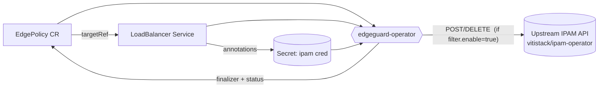

# 🛡️ edgeguard-operator

> A Kubernetes operator that guards LoadBalancer Services at the edge — discovering their ports and ingress IPs, protecting them with finalizers, and reporting them to an upstream IPAM / edge API.

<p>
  
  
  
  
  
</p>

---

## 📖 Overview

`edgeguard-operator` introduces a single Custom Resource — **`EdgePolicy`** — that attaches a security and discovery policy to a Kubernetes `Service` of type `LoadBalancer` in the same namespace.

Its purpose is to **stop unwanted traffic at the very tip of the edge — as it enters the datacenter** — rather than after it has already reached the workloads inside. By discovering each guarded Service's ports and ingress IPs and reporting them upstream, the operator lets the edge enforce what should be allowed in before traffic crosses the datacenter boundary.

For each `EdgePolicy` the operator:

- 🔗 **Protects the target Service** with a finalizer, so the policy can react before the Service is deleted.
- 🔎 **Discovers** the Service's ports and load balancer ingress IPs (split into IPv4 / IPv6).
- 📡 **Reports** the discovered state to an external upstream API (opt-in via `spec.filter.enable`), enriched with the datacenter, any user-declared additional ports, an IPAM zone, and a credential resolved from a Kubernetes `Secret`. When a policy or its Service is removed, the operator **withdraws** the report with an HTTP `DELETE`.
- 🌍 **Declares an allowed region** policy (`norway` / `nordics` / `europe`) plus optional extra CIDR allowances.
- 🧭 **Surfaces everything on `.status`** as standard `metav1.Condition`s, visible with `kubectl get edgepolicies`.

Reconciliation is **idempotent** and tolerant: missing Secrets, missing upstream configuration, and transient upstream outages are surfaced on the status rather than crashing the reconcile loop.

> 🔗 **Dependency:** `edgeguard-operator` is designed to work alongside the [**vitistack/ipam-operator**](https://github.com/vitistack/ipam-operator). The IPAM operator provisions the LoadBalancer addressing and backs the upstream IPAM API that receives the port reports; the `ipam.vitistack.io/zone` and `ipam.vitistack.io/secret` Service annotations map to its zone and credential model.

---

## ⚙️ How it works



1. An `EdgePolicy` references a `Service` by name via `spec.targetRef`.
2. The operator adds a finalizer to the Service and reads its ports and ingress IPs.
3. If `spec.filter.enable` is set, it resolves the IPAM credential + zone and **POSTs a port report** upstream; when the policy or its Service goes away it sends a **`DELETE`** to withdraw it.
4. The policy `.status` reflects the outcome through the `Ready`, `IpamSecretReady`, and `UpstreamReady` conditions.

---

## 🧩 The `EdgePolicy` API

**Group / Version / Kind:** `security.vitistack.io/v1alpha1`, `Kind: EdgePolicy` (short name: `epol`)

### Spec fields

| Field | Type | Required | Description |
|-------|------|----------|-------------|
| `targetRef.apiVersion` | string (`v1`) | ✅ | API version of the target. Only `v1` is supported. |
| `targetRef.kind` | string (`Service`) | ✅ | Target kind. Only `Service` is supported. |
| `targetRef.name` | string | ✅ | Name of the target Service, in the **same namespace** as the policy. |
| `filter.enable` | bool | ⬜ | Enables service port discovery **and** upstream reporting. Defaults to `false` when omitted. |
| `filter.additionalPortList` | []AdditionalPort | ⬜ | Extra user-declared ports reported upstream alongside the discovered Service ports (max 256). |
| `datacenter` | enum | ✅ | Availability zone the policy belongs to, reported upstream. One of `no-east-az1`, `no-east-az2`, `no-central-az1`, `no-central-az2`, `no-west-az1`, `no-west-az2`, `no-north-az1`, `no-north-az2`. |
| `allowedRegion.region` | enum | ⬜ | One of `norway`, `nordics`, `europe`. |
| `allowedRegion.additionalAllowList` | []CIDR | ⬜ | Extra IPv4/IPv6 CIDRs allowed regardless of region (max 256). |

**`AdditionalPort`** (each entry in `filter.additionalPortList`):

| Field | Type | Required | Description |
|-------|------|----------|-------------|
| `name` | string | ⬜ | Optional label for the port (max 63 chars). |
| `port` | int32 | ✅ | Port number, `0`–`65535`. |
| `protocol` | enum | ✅ | One of `TCP`, `UDP`, `ICMP`, `ESP`, `AH`, `SCTP`, `GRE`, `OSPF`, `IGMP`. |

> ℹ️ Validation rule: **at least one** of `filter` or `allowedRegion` must be set.

### Example

```yaml
apiVersion: security.vitistack.io/v1alpha1
kind: EdgePolicy
metadata:
  name: my-edge-policy
  namespace: default
spec:
  targetRef:
    apiVersion: v1
    kind: Service
    name: my-service
  datacenter: no-east-az1
  filter:
    enable: true
    additionalPortList:
      - name: ping
        port: 0
        protocol: ICMP
      - name: custom-app
        port: 8100
        protocol: TCP
  allowedRegion:
    region: norway
    additionalAllowList:
      - 192.0.2.0/24
      - 2001:db8::/48
```

### Target Service annotations

When `filter.enable` is set, the operator reads these annotations from the **target Service**:

| Annotation | Purpose |
|------------|---------|
| `ipam.vitistack.io/zone` | Reported upstream as `ipamZone`. |
| `ipam.vitistack.io/secret` | Name of the `Secret` holding the IPAM credential. The special value `default` resolves to `ipam-system/default`; any other value resolves to a Secret of that name in the Service's own namespace. The credential is read from the Secret's **`secret`** data key. |

---

## 📊 Status & conditions

Check a policy at a glance:

```sh
kubectl get edgepolicies           # Target, Ready, Age
kubectl get epol -o wide           # + Reason, Secret, Upstream
```

The operator maintains three conditions on `.status.conditions`:

| Condition | Reason | Meaning |
|-----------|--------|---------|
| **Ready** | `ServiceProtected` | Finalizer present; Service is managed and (if reporting is enabled) the last report was accepted upstream. |
| | `ServiceNotFound` | Target Service does not exist (yet). |
| | `ServiceTerminating` | Target Service is being deleted. |
| | `ServiceNotLoadBalancer` | Target Service is not of type `LoadBalancer`. |
| | `UpstreamReportIncomplete` | A required report field (the IPAM credential and/or a load balancer address) is missing, so the report was not sent — not ready until it resolves. |
| | `UpstreamReportFailed` | The last upstream report failed transiently (connectivity, or a 5xx); a retry is pending. |
| | `UpstreamReportRejected` | The upstream refused the report with a 4xx; treated as terminal — not retried on the timer, and the identical payload is suppressed until the report content changes. |
| **IpamSecretReady** | `SecretResolved` | Credential resolved successfully. |
| | `SecretNotFound` | Referenced Secret does not exist (tolerated — empty credential). |
| | `SecretInvalid` | Secret exists but has no `secret` key (tolerated). |
| | `SecretNotConfigured` | Service has no `ipam.vitistack.io/secret` annotation. |
| **UpstreamReady** | *(absent)* | Healthy — reporting succeeded, or is intentionally disabled. |
| | `UpstreamNotConfigured` | `filter.enable` is set but no `UPSTREAM_API_URL` is configured. |
| | `UpstreamReportIncomplete` | The report is missing a field the upstream requires — the IPAM credential (`ipamSecret`) and/or a load balancer address — so it was **not** sent. Clears once the credential resolves and the Service has an ingress IP. |
| | `UpstreamReportFailed` | Configured, but the last report failed **transiently** (connectivity, or a `5xx`); a retry is pending. |
| | `UpstreamReportRejected` | The upstream refused the report with a **`4xx`** client error. Treated as **terminal**: the operator stops retrying on the timer and suppresses the identical payload (remembered via `.status.rejectedReportKey`), re-attempting only when the report content changes. |

---

## 🔧 Configuration (environment variables)

The manager is configured with environment variables (each also has an equivalent CLI flag):

| Env var | Flag | Default | Description |
|---------|------|---------|-------------|
| `UPSTREAM_API_URL` | `--upstream-url` | *(empty)* | Base URL of the upstream API that receives port reports, e.g. `https://ipam-api.vitistack.io/v2`. When empty, policies with `filter.enable: true` report `UpstreamReady=False/UpstreamNotConfigured`. |
| `UPSTREAM_REPORTING_DISABLED` | `--disable-upstream-reporting` | `false` | When truthy (`1`, `t`, `true`, …), upstream reporting is **disabled**: every report is treated as successfully delivered without any outbound call, and no failure condition is raised. **Takes precedence over `UPSTREAM_API_URL`.** |
| `UPSTREAM_INSECURE_SKIP_VERIFY` | `--upstream-insecure-skip-verify` | `false` | When truthy, **skips upstream TLS certificate verification**. For trusted dev/test mirrors with self-signed certificates only — **do not enable in production**. Prefer mounting a CA bundle (see the Helm chart's `manager.caBundle`). |

### Reporting modes at a glance

| Configuration | Behavior | `UpstreamReady` |
|---------------|----------|-----------------|
| `UPSTREAM_REPORTING_DISABLED=true` | No-op; reports treated as delivered | *(absent — healthy)* |
| `UPSTREAM_API_URL` set | Real HTTP `POST` / `DELETE` | *(absent — healthy)* |
| Neither set (with `filter.enable: true`) | Report skipped | `UpstreamNotConfigured` |

> **Transient** failures (DNS, connectivity, `5xx`) are **soft**: they are logged at `INFO`, surfaced as `UpstreamReportFailed` (which also drives `Ready=False`), and requeued for retry on a timer — not raised as a hard reconcile error. Observed ports are not persisted on failure, so the retry re-sends the same payload.
>
> A **`4xx`** response is treated as **terminal** (`UpstreamReportRejected`, also `Ready=False`): retrying the same payload will not help, so the operator does **not** requeue on the timer. It also **remembers the rejected report** (by its `Idempotency-Key`) on `.status.rejectedReportKey` and **suppresses re-sending that identical payload** on subsequent reconciles and Service events — it re-attempts only once the report content actually changes (which yields a different key), or clears the memory when a report is accepted. During deletion, a `4xx` on the withdrawal is skipped rather than retried, so a rejected withdrawal never blocks the object from deleting.

---

## 📡 Upstream reporting contract

When reporting is enabled and ports/IPs change, the operator sends a report; when the policy or its target Service is removed, it withdraws it:

```
POST   <UPSTREAM_API_URL>     # add / update
DELETE <UPSTREAM_API_URL>     # withdraw on removal
Content-Type: application/json
Idempotency-Key: <sha256 hash>
```

### Payload

```json
{
  "clusterId": "<UID of the kube-system namespace>",
  "edgePolicyNamespaceId": "<UID of the policy's namespace>",
  "edgePolicyId": "<UID of the EdgePolicy object>",
  "serviceName": "my-service",
  "datacenter": "no-east-az1",
  "ipamZone": "inet",
  "ipamSecret": "<resolved credential>",
  "ipv4Addresses": ["203.0.113.10"],
  "ipv6Addresses": ["2001:db8::10"],
  "observedPorts": [{ "name": "https", "port": 443, "protocol": "TCP" }],
  "additionalPorts": [{ "name": "ping", "port": 0, "protocol": "ICMP" }]
}
```

- `observedPorts` are the ports discovered on the target Service (TCP/UDP/SCTP).
- `additionalPorts` are the user-declared ports from `spec.filter.additionalPortList`.
- The `DELETE` payload is reconstructed from the policy's last observed status plus the datacenter and additional ports, and **carries the IPAM credential** (`ipamSecret`) — the upstream requires it to authorize the withdrawal. It is resolved best-effort from the target Service's annotations; if the Service is already gone, `ipamSecret` and `ipamZone` are omitted.

> ⚠️ **Required fields.** Every `POST` and `DELETE` must carry the IPAM credential (`ipamSecret`) **and** at least one load balancer address (`ipv4Addresses` or `ipv6Addresses`). If either is missing the operator does **not** send the request:
> - For a `POST`, the policy is marked `UpstreamReady=False/UpstreamReportIncomplete` (and `Ready=False` for the same reason) and the report is retried (observed ports are not persisted) until the credential resolves and the Service has an ingress IP.
> - For a `DELETE`, an incomplete withdrawal is skipped rather than sent — so a policy whose credential can no longer be resolved is never blocked from deleting.

### 🔑 The `Idempotency-Key` header

Every report carries an **`Idempotency-Key`** HTTP header so the upstream can safely deduplicate retries and duplicates:

- The key is a **SHA-256 hash** derived only from the **dedupe-relevant content**: the service name, the datacenter, the discovered ports, the additional ports, and the load balancer IPs.
- Fields that don't change the *meaning* of the report — `clusterId`, `edgePolicyNamespaceId`, `edgePolicyId`, `ipamZone`, and `ipamSecret` — are **deliberately excluded**. Rotating a credential alone will not defeat deduplication.
- Two reports describing the same content produce the **same key**, so an upstream that honors the header can treat a retried or duplicate request (e.g. one re-sent after a reconcile conflict or a transient failure) as the **same request** and ignore it.

> The operator uses report-before-persist ordering: it sends upstream *before* writing `.status.observedPorts`. In the rare crash window between a successful POST and the status write, the same report may be sent again on restart — the `Idempotency-Key` is what makes that safe. **The upstream must honor the header for exactly-once semantics.**

> 🔒 Security note: the resolved IPAM credential is serialized into the `ipamSecret` field of the outbound payload but is **never logged** — the controller's report log line records only counts, not the credential.

---

## 🚀 Getting Started

### Prerequisites
- Go **v1.27.2+**
- Docker **17.03+**
- kubectl **v1.31+**
- Access to a Kubernetes **v1.31+** cluster — required because the API contract uses **CEL validation rules** (`x-kubernetes-validations`), which need CRD validation expressions that are GA from Kubernetes 1.31.
- The [**vitistack/ipam-operator**](https://github.com/vitistack/ipam-operator) deployed in the cluster (provides the upstream IPAM API and LoadBalancer addressing this operator reports to).

### Deploy to a cluster

```sh
# 1. Build and push the manager image
make docker-build docker-push IMG=<some-registry>/edgeguard-operator:tag

# 2. Install the CRDs
make install

# 3. Deploy the controller (configure upstream reporting as needed)
make deploy IMG=<some-registry>/edgeguard-operator:tag
```

Configure upstream reporting on the Deployment by setting the environment variables above on the `manager` container, e.g. `UPSTREAM_API_URL` or `UPSTREAM_REPORTING_DISABLED=true`.

### Try it out

```sh
kubectl apply -k config/samples/
kubectl get epol -o wide
```

### Uninstall

```sh
kubectl delete -k config/samples/   # remove sample CRs
make uninstall                       # remove CRDs
make undeploy                        # remove the controller
```

---

## 🛠️ Development

```sh
make manifests   # regenerate CRDs/RBAC from markers (after editing *_types.go)
make generate    # regenerate DeepCopy methods
make lint        # run golangci-lint
make test        # run unit tests (envtest: real K8s API + etcd)
make run         # run locally against your current kubeconfig context
```

Tests use **Ginkgo + Gomega**; see `internal/controller/suite_test.go` for the envtest setup.

### Project layout

```
cmd/main.go                        Manager entry point & flag/env wiring
api/v1alpha1/edgepolicy_types.go   EdgePolicy CRD schema (+kubebuilder markers)
internal/controller/               Reconciliation logic
internal/upstream/                 Upstream Reporter (HTTP + no-op) & port report
config/                            Kustomize manifests (CRDs, RBAC, samples)
```

---

## 📦 Distribution

**YAML bundle:**

```sh
make build-installer IMG=<some-registry>/edgeguard-operator:tag
kubectl apply -f https://raw.githubusercontent.com/<org>/edgeguard-operator/<tag>/dist/install.yaml
```

**Helm chart:**

The chart lives at `chart/edgeguard-operator`:

```sh
helm install edgeguard ./chart/edgeguard-operator \
  --namespace edgeguard-system --create-namespace \
  --set manager.image.repository=<some-registry>/edgeguard-operator \
  --set manager.image.tag=<tag>
```

Notable values (see `chart/edgeguard-operator/values.yaml`):

- **`manager.env`** — upstream reporting configuration (`UPSTREAM_API_URL`, `UPSTREAM_REPORTING_DISABLED`, `UPSTREAM_INSECURE_SKIP_VERIFY`).
- **`manager.caBundle`** — mount a CA certificate bundle from a ConfigMap so the manager can verify TLS against an upstream signed by an internal/corporate CA (preferred over `UPSTREAM_INSECURE_SKIP_VERIFY`):

  ```sh
  --set manager.caBundle.enabled=true \
  --set manager.caBundle.configMapName=nhn-certbundle   # your ConfigMap
  ```

  You create the ConfigMap (with key/file `caBundle.fileName`, default `nhn-certbundle.crt`) in the release namespace; the chart mounts it at `caBundle.mountPath` (default `/etc/ssl/certs/nhn-certbundle.crt`).
- **`crd.enabled` / `crd.keep`** — install the `EdgePolicy` CRD with the chart and keep it on uninstall.

Run `make help` for the full list of targets. More context is in the [Kubebuilder Documentation](https://book.kubebuilder.io/introduction.html).

---

## 📄 License

Copyright 2026.

Licensed under the Apache License, Version 2.0 (the "License");
you may not use this file except in compliance with the License.
You may obtain a copy of the License at

    http://www.apache.org/licenses/LICENSE-2.0

Unless required by applicable law or agreed to in writing, software
distributed under the License is distributed on an "AS IS" BASIS,
WITHOUT WARRANTIES OR CONDITIONS OF ANY KIND, either express or implied.
See the License for the specific language governing permissions and
limitations under the License.
